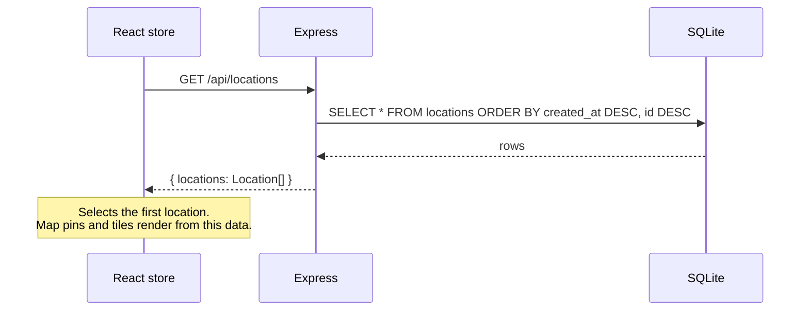
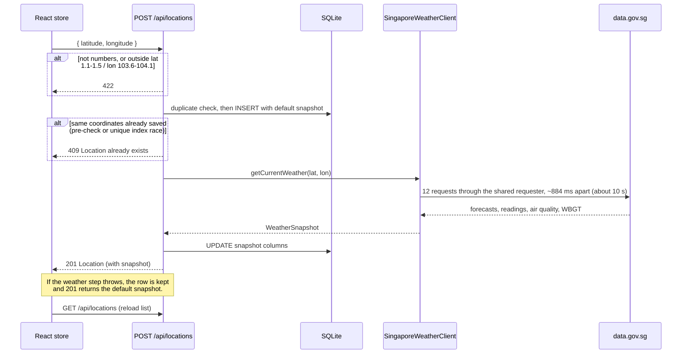
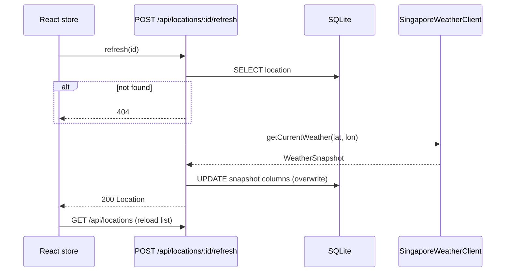
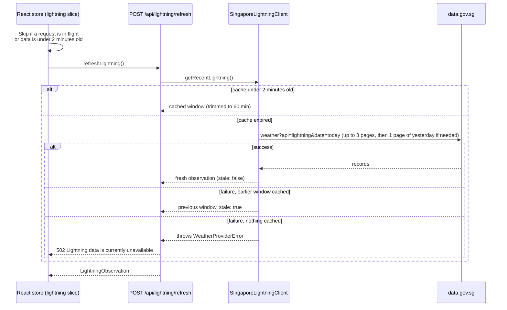

The dashboard never calls data.gov.sg on page load. Each saved location holds one `WeatherSnapshot` in SQLite, and that snapshot only changes when the location is created or refreshed.

## Page load

No weather call happens here. A location that has never been refreshed carries the default snapshot (`condition: "Not refreshed"`, `source: "not-refreshed"`, all readings `null`), which the UI shows as `--°`.

## Creating a location

The insert comes first so a saved location survives any upstream failure.

## Refreshing a location

Each refresh overwrites the previous snapshot. There is no history table.

:::note[When does refresh return 502?]
The route maps a thrown `WeatherProviderError` to `502`. In practice `SingaporeWeatherClient` catches the failure of each upstream call and substitutes `null` values, so a refresh during an outage usually returns `200` with `condition: "Unavailable"` and empty readings. The `502` path is reached by custom or fake clients that throw.
:::

## Lightning (the exception)

Lightning is island-wide, not tied to a location, and is fetched only on an explicit user action: turning the layer on, pressing its refresh button, or clicking the idle prompt.

Nothing from lightning is written to SQLite or to any `WeatherSnapshot`. Concurrent requests share one in-flight upstream fetch. On the client, strikes keep fading and drop off after 60 minutes on a 30-second timer with no further network calls.

## Frontend interaction logging

Store actions call `logInteraction(event, metadata)`, which posts to `POST /api/logs` with `keepalive: true` and ignores failures. The server validates the event name against `^[a-z][a-z0-9_.:-]{1,63}$` and writes it to the pino log with `source: "frontend"`. Events include `location_create_submitted`, `location_created`, `location_refresh_clicked`, `location_deleted`, `lightning_toggled`, `lightning_refreshed` and `map_expanded`.
