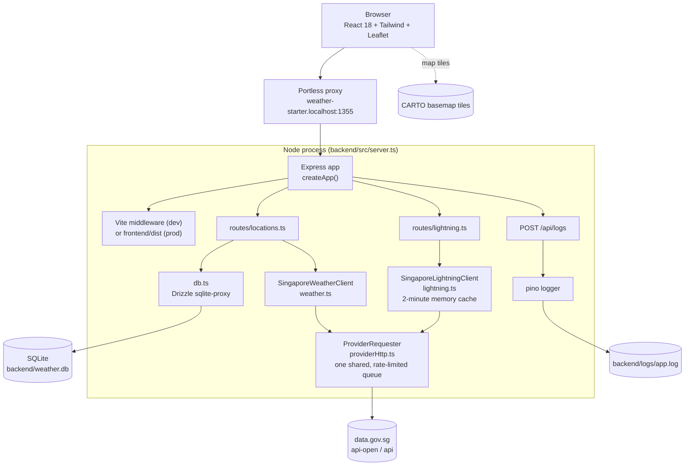
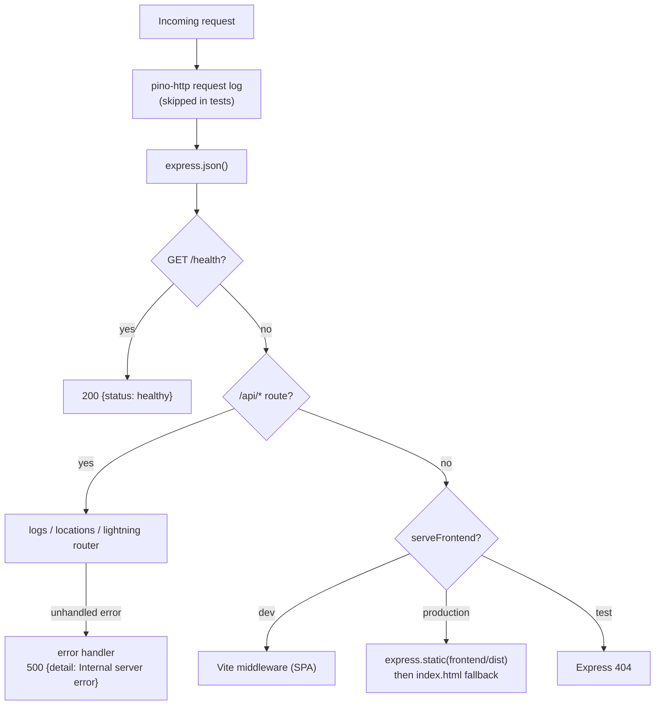

Weather Starter is one Node process. Express handles `/api/*` and, outside tests, also serves the React app: through Vite middleware in development, or as static files from `frontend/dist` in production.

## System architecture

In production there is no Portless: `npm run start` runs `backend/dist/server.js` with `NODE_ENV=production`, listening on `127.0.0.1:$PORT`.

## Design rules

These come from the project constitution (`.specify/memory/constitution.md`) and shape every change.

| Rule | What it means in the code |
| --- | --- |
| **Snapshot-only weather** | data.gov.sg is called only on location create or refresh. `GET /api/locations` reads SQLite only. Map pins come from that same data. |
| **Lightning exception** | `POST /api/lightning/refresh` may call data.gov.sg on a user action. Results are cached 2 minutes and never stored. |
| **One process, relative API** | The frontend calls `/api/*` only. All server state lives in `frontend/src/state/store.tsx`. There is no router. |
| **Injectable providers** | `createApp({ weatherClient, lightningClient })`. Tests inject fakes and never reach the network. |
| **Theme-driven UI** | Colours come from CSS variables through Tailwind's `white` alias, panels use `rounded-card`. |

## Request routing

## Startup sequence

1. `server.ts` imports `dotenv/config`, then the routers, which import `db.ts`.
2. `db.ts` opens SQLite with WAL mode and runs Drizzle migrations from `backend/drizzle/` using top-level `await`. If that fails it logs the cause and the process exits non-zero. The database file is never deleted or recreated.
3. `createApp()` builds the app. If `LIGHTNING_FIXTURE=demo` and not in production, it swaps in the fixture lightning client.
4. When run directly (not imported by tests), the app listens on `127.0.0.1:${PORT ?? 3000}`.
