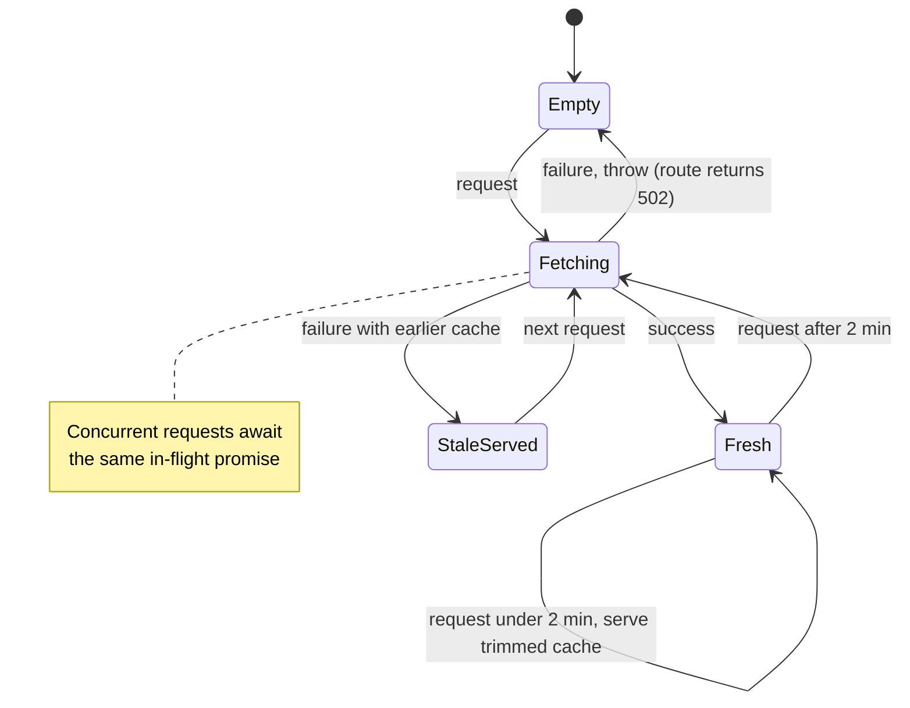

Lightning strikes are the one weather call outside a location create or refresh. They are island-wide, so they do not belong in any location's snapshot, and they are never stored in SQLite.

`backend/src/lightning.ts` exports `SingaporeLightningClient`, which implements:

```ts
interface LightningClient {
  getRecentLightning(now?: Date): Promise<LightningObservation>;
}
```

`routes/lightning.ts` exposes it as `POST /api/lightning/refresh`. Inject a different client with `createApp({ lightningClient })`.

## Cache states

One observation is cached in memory per client instance and shared by every caller.



- **Fresh window:** 2 minutes (`FRESH_MS = 120_000`). Within it, repeated calls return the cached strikes trimmed to the last 60 minutes, with no upstream request.
- **Stale fallback:** if a fetch fails and something is cached, the previous window is returned with `stale: true`. The frontend shows "Lightning data is currently unavailable" but keeps the strikes on the map.
- **No cache and a failure:** the client throws `WeatherProviderError`, and the route returns `502`.

## Fetching

The dataset is `GET /v2/real-time/api/weather?api=lightning&date=YYYY-MM-DD`, paged by `paginationToken`, newest records first.

1. Work out today's date in Singapore time (UTC+8), and the date 60 minutes ago.
2. Read up to 3 pages of today, stopping as soon as a page reaches back past the 60-minute cutoff.
3. If the window crosses midnight in Singapore, read 1 page of the previous date.

`normaliseStrikes` then:

- reads each reading's coordinates and keeps only valid WGS84 values,
- uses the reading's `datetime`, falling back to the record's,
- keeps strikes from the last 60 minutes, allowing up to 5 minutes in the future for clock skew,
- de-duplicates by id and sorts newest first.

Strikes outside Singapore itself (Johor, the Riau islands, the Strait) are kept on purpose, because the provider's feed covers the wider region.

## Development fixture

Set `LIGHTNING_FIXTURE=demo` in `.env` and restart `npm run dev`. `createFixtureLightningClient()` in `lightningFixture.ts` returns three strikes aged 2, 30 and 55 minutes at request time, so you can see the fade without waiting for a storm. The server logs a warning on startup. The fixture is ignored when `NODE_ENV=production`.
