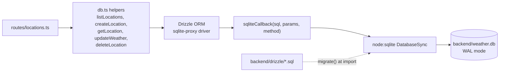
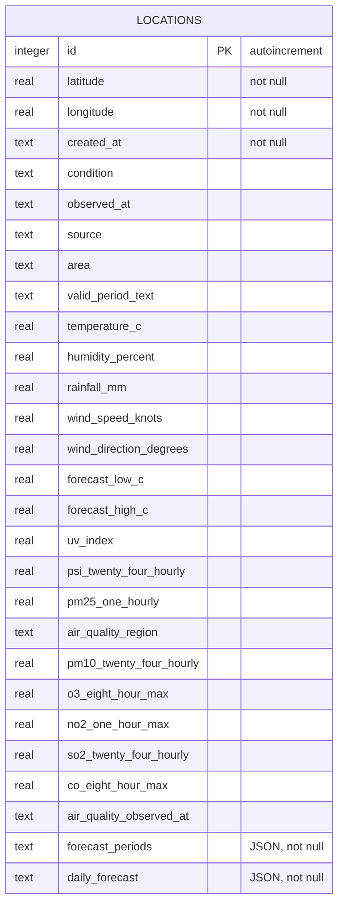

`backend/src/db.ts` uses Node's built-in `node:sqlite` (`DatabaseSync`) behind Drizzle's `sqlite-proxy` driver. There is no native SQLite package to compile.



## Database file

- Path: `DATABASE_PATH`, or `backend/weather.db` relative to the working directory. The parent folder is created if missing.
- `PRAGMA journal_mode = WAL`, so you will also see `weather.db-wal` and `weather.db-shm`.
- `npm run reset` deletes all three files.

## Startup and migrations

`db.ts` opens the database and runs migrations from `backend/drizzle/` with top-level `await` when it is first imported. Any failure is logged as `could not open or migrate the database` and rethrown, so the server exits non-zero. The file is never deleted or recreated, so saved locations survive a bad migration.

To change the schema:

```bash
# 1. edit backend/src/schema.ts
npm run db:generate   # writes backend/drizzle/NNNN_*.sql and meta/
# 2. restart npm run dev; the migration applies on startup
```

## The `locations` table

One row per saved location. The latest snapshot is stored in the same row, one column per reading. The two list fields are JSON text.



A unique index `locations_latitude_longitude_unique` on `(latitude, longitude)` stops duplicates.

## Data access helpers

| Function | Behaviour |
| --- | --- |
| `listLocations()` | All rows, `created_at DESC, id DESC` |
| `createLocation(lat, lon)` | Checks for a duplicate, then inserts with the default snapshot. A duplicate, including one that slips past the check under concurrency and hits the unique index, throws an error named `DuplicateLocationError` (mapped to `409`). |
| `getLocation(id)` | One row or `null` |
| `updateWeather(id, snapshot)` | Overwrites every snapshot column, returns the updated record |
| `deleteLocation(id)` | `true` if a row was removed |
| `resetStore()` | Test helper: deletes all rows and resets the autoincrement |
| `closeDatabase()` | Test helper: closes the handle |

Rows are converted to API records by `rowToRecord`, which nests the snapshot columns under `weather` with snake_case keys.
