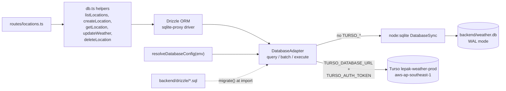
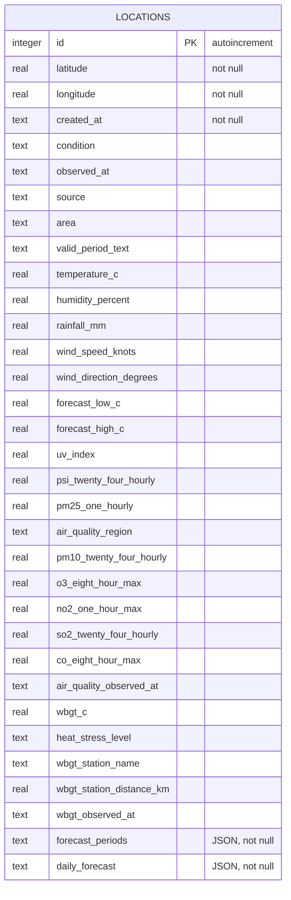

`backend/src/db.ts` uses Drizzle's `sqlite-proxy` driver over an adapter (`backend/src/dbAdapter.ts`) that picks one of two stores:
- **Local:** Node's built-in `node:sqlite` (`DatabaseSync`), the default for development, tests and browser checks.
- **Turso:** the hosted libSQL database used in production, through `@libsql/client/web` (pure JS over HTTP).

Neither needs a native SQLite package to compile.



## Choosing the store

`resolveDatabaseConfig` (`backend/src/dbConfig.ts`):

| Situation | Result |
| --- | --- |
| Both `TURSO_DATABASE_URL` and `TURSO_AUTH_TOKEN` set | Turso |
| Neither set | Local file |
| Only one set | Startup error |
| `DATABASE_REQUIRE_REMOTE=true` (set in the container image) without Turso | Startup error |
| `NODE_ENV=test` with Turso | Startup error |

vitest (`vitest.config.ts`) and the e2e server (`scripts/e2e/lib.sh`) blank `TURSO_*`, so tests never reach the hosted database even if `.env` points at it. Error messages name variables, never values. Hosting and secrets: see `docs/deployment.md`.

## Database file (local mode)

- Path: `DATABASE_PATH`, or `backend/weather.db` relative to the working directory. The parent folder is created if missing.
- `PRAGMA journal_mode = WAL`, so you will also see `weather.db-wal` and `weather.db-shm`.
- `npm run reset` deletes all three files.

## Startup and migrations

`db.ts` opens the database and runs migrations from `backend/drizzle/` with top-level `await` when it is first imported. Success is logged as `database ready` with `kind` (`local` or `turso`) and `migrationsApplied`. Any failure is logged as `could not open or migrate the database` and rethrown, so the server exits non-zero. Nothing is ever deleted or recreated, so saved locations survive a bad migration. Both stores use the same `sqlite-proxy` migrator and `__drizzle_migrations` table.

To change the schema:

```bash
# 1. edit backend/src/schema.ts
npm run db:generate   # writes backend/drizzle/NNNN_*.sql and meta/
# 2. restart npm run dev; the migration applies on startup
```

## The `locations` table

One row per saved location. The latest snapshot is stored in the same row, one column per reading. The two list fields are JSON text.



A unique index `locations_latitude_longitude_unique` on `(latitude, longitude)` stops duplicates.

## Data access helpers

| Function | Behaviour |
| --- | --- |
| `listLocations()` | All rows, `created_at DESC, id DESC` |
| `createLocation(lat, lon)` | Checks for a duplicate, then inserts with the default snapshot. A duplicate, including one that slips past the check under concurrency and hits the unique index, throws an error named `DuplicateLocationError` (mapped to `409`). |
| `getLocation(id)` | One row or `null` |
| `updateWeather(id, snapshot)` | Overwrites every snapshot column, returns the updated record |
| `deleteLocation(id)` | `true` if a row was removed |
| `resetStore()` | Test helper: deletes all rows and resets the autoincrement |
| `closeDatabase()` | Closes the handle (tests, and the server's `SIGTERM` shutdown) |

Rows are converted to API records by `rowToRecord`, which nests the snapshot columns under `weather` with snake_case keys.
