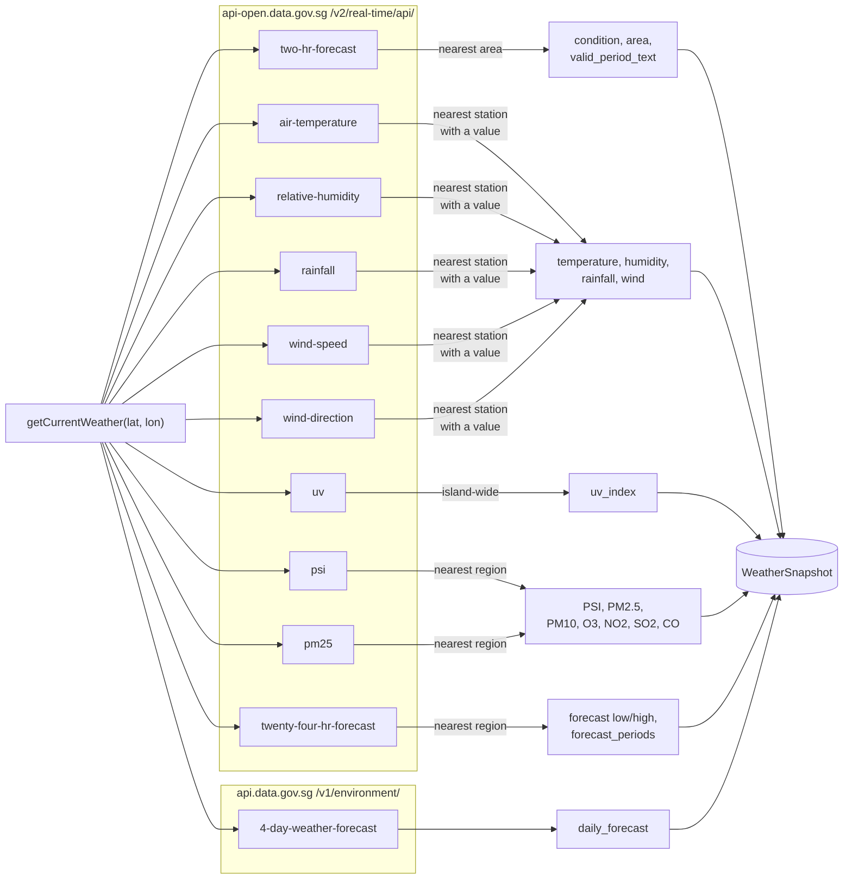
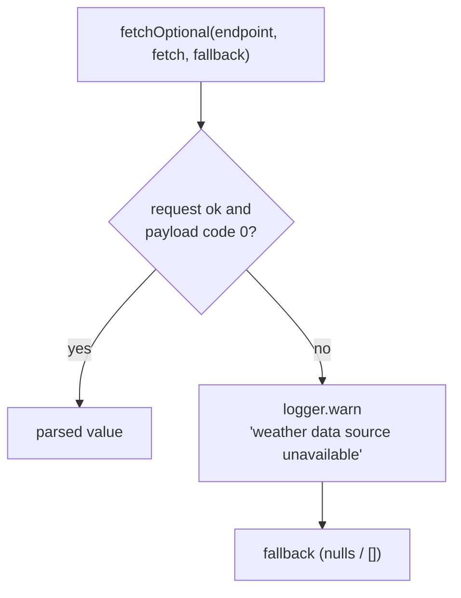

`backend/src/weather.ts` exports `SingaporeWeatherClient`. Its one public entry point used by the routes is:

```ts
getCurrentWeather(latitude: number, longitude: number): Promise<WeatherSnapshot>
```

The routes depend only on the `WeatherClient` interface (`routes/locations.ts`), so tests can pass any object with that method to `createApp({ weatherClient })`.

## Upstream calls

One refresh makes 11 requests. They are started together with `Promise.all`, but the shared `ProviderRequester` spaces them 250 ms apart, so a refresh takes roughly 3 seconds or more.



| Field group | Endpoint | Matching |
| --- | --- | --- |
| `condition`, `area`, `valid_period_text` | `two-hr-forecast` | Nearest `area_metadata` label location |
| `temperature_c`, `humidity_percent`, `rainfall_mm`, `wind_*` | `air-temperature`, `relative-humidity`, `rainfall`, `wind-speed`, `wind-direction` | Nearest station that reported a numeric value in the latest reading |
| `uv_index` | `uv` | Island-wide |
| `psi_twenty_four_hourly`, pollutant fields, `air_quality_*` | `psi` | Nearest region from `regionMetadata` |
| `pm25_one_hourly` | `pm25` | Same region |
| `forecast_low_c`, `forecast_high_c` | `twenty-four-hr-forecast` | Island-wide general temperature |
| `forecast_periods` | `twenty-four-hr-forecast` | Nearest of the five fixed regions, falling back to `central` |
| `daily_forecast` | `4-day-weather-forecast` (legacy v1 host) | Island-wide |

"Nearest" is the smallest squared difference in latitude and longitude. That is fine at Singapore's scale and avoids a haversine.

The pollutant breakdown comes from the same `psi` response as the PSI value, so it adds no extra call.

`observed_at` is the latest timestamp across all sources that returned one.

## Partial failure

Every upstream call is wrapped in `fetchOptional`. If a call fails, the client logs `weather data source unavailable` with the endpoint name and uses a fallback (`null` values or an empty list). The other fields still fill in.



If the 2-hour forecast fails, the snapshot starts from an empty one with `condition: "Unavailable"`. As a result `getCurrentWeather` almost never throws. The location still updates, just with `null` readings.

## Shared HTTP behaviour

`backend/src/providerHttp.ts` holds `ProviderRequester`, used by both the weather and lightning clients. Each client creates its own instance, so spacing applies per client.

- **Spacing:** requests are queued so they start at least 250 ms apart.
- **Timeout:** 8 seconds per request via `AbortController`.
- **Rate limit:** one retry after 1 second on HTTP 429. A second 429 throws.
- **Headers:** `Accept: application/json`, a `User-Agent` of `weather-starter/0.1 (educational project)`, and `x-api-key` when `WEATHER_API_KEY` is set.
- **Errors:** everything becomes a `WeatherProviderError` with a safe message: rate limit, rejected key (401/403), other HTTP status, or "Unable to reach weather provider".

## Adding a new reading

1. Add the field to `WeatherSnapshot` in `backend/src/schema.ts` and a column to the `locations` table.
2. Run `npm run db:generate` to create a migration in `backend/drizzle/`.
3. Map it in `weatherToColumns` and `rowToRecord` in `backend/src/db.ts`, and add it to `defaultWeather`.
4. Fetch it in `getCurrentWeather` inside `fetchOptional`, with a `null` fallback.
5. Add it to `frontend/src/types.ts` and render it, typically as a tile in `Tiles.tsx`.
6. Extend `backend/src/weather.test.ts` with a stubbed `fetch` response.

Each new endpoint adds about 250 ms to every refresh.
