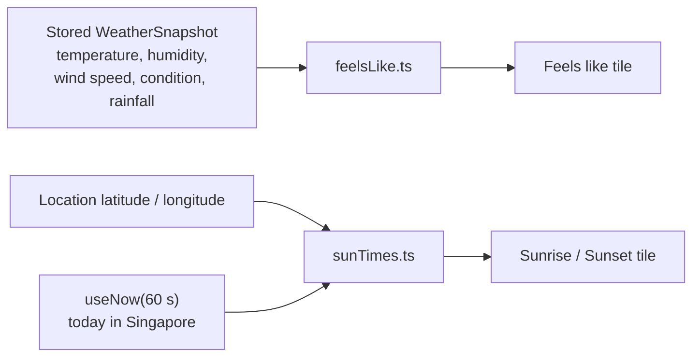

Two tiles are computed on the client and never stored or fetched. Both are pure modules with unit tests, which is the pattern for any logic worth testing in the frontend.



## Feels like (`components/feelsLike.ts`)

Steadman apparent temperature, the non-radiation form used by Australia's Bureau of Meteorology:

```text
AT = Ta + 0.33·e − 0.70·ws − 4.00
e  = (RH / 100) · 6.105 · exp(17.27·Ta / (237.7 + Ta))     water vapour pressure, hPa
```

`Ta` is air temperature in °C, `RH` relative humidity in %, `ws` wind speed in m/s (converted from knots). The result is rounded half-up to one decimal.

- **No reading:** if temperature or humidity is missing, the tile shows "No reading" with a hint such as "Needs temperature and humidity".
- **Approximate:** if wind is missing, it is treated as 0 and the value is marked approximate.

The value picks a comfort band. Lower bounds are inclusive.

| Band | From (°C) | Advice (shortened) |
| --- | --- | --- |
| Chilly | below 24 | Jacket or hoodie |
| Breezy & Cool | 24 | Light layer |
| Warm | 27 | Standard light wear |
| Hot & Muggy | 32 | Breathable, loose fabrics; UV umbrella in open sun |
| Scorching | 37 | Minimal clothing and sun gear |

An umbrella note appears when the 2-hour forecast mentions rain, showers or thunder, or the nearest station recorded more than 0.1 mm of rain.

## Sunrise and sunset (`components/sunTimes.ts`)

NOAA's general solar position approximation: fractional year, then equation of time and solar declination, then the hour angle at a zenith of 90.833° (which allows for refraction and the sun's radius). It is accurate to about a minute near the equator and makes no network call.

The date is always today's date in Singapore (`singaporeDate()`), whatever the browser's time zone, and times are formatted in Singapore time. The tile re-reads the clock every 60 seconds, so it rolls over at midnight without a reload.
