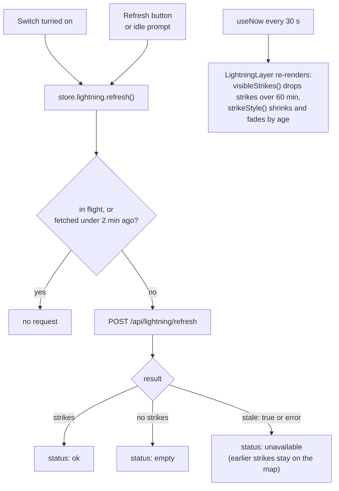

The map lives in `frontend/src/components/map/` and uses Leaflet through react-leaflet.

| File | Role |
| --- | --- |
| `MapCard.tsx` | Card in the hero: a non-interactive preview, the expand button and the Layers control |
| `MapLayersControl.tsx` | The card's one Layers button (Rain and Lightning switches, rain legend) and its single combined status strip |
| `MapFullscreen.tsx` | Fullscreen overlay rendered in a portal. Escape closes it, focus moves to the close button and returns afterwards. |
| `WeatherMap.tsx` | The map itself: CARTO tiles, pins, fit-to-bounds, focus on the selected location |
| `mapHelpers.ts` | Pure helpers: condition to icon, pin label, bounds, Singapore centre/bounds, coarse-pointer check |
| `LightningLayer.tsx` | One fading circle per strike |
| `LightningControl.tsx` | `LightningButtons` (refresh and on/off switch) and `LightningStatusStrip`, placed by the full-screen map and the card's Layers menu |
| `lightningHelpers.ts` | Pure lightning logic: freshness, visibility, fade style, status text, popup text |
| `RainLayer.tsx` | One symbol per rain station in the `rain` pane (below lightning and pins), with a popup |
| `RainControl.tsx` | Rain switch, refresh button, status strip and legend (full-screen map), shared pieces for the card |
| `rainHelpers.ts` / `rainMarker.ts` | Pure rain logic (levels, coverage, out of date, status and popup text, preference) and symbol markup |
| `useNow.ts` | A clock that re-renders on an interval |

## Pins

Pins come from the locations already in the store, so the map makes no weather calls of its own. Each pin is a `DivIcon` showing a condition icon (thunder, rain, cloud or sun, chosen by `conditionToIcon`) and a temperature label. Clicking a pin selects that location.

The card preview is not interactive. On touch devices, tapping its background opens the fullscreen map. Selecting a location, or refreshing the selected one, re-centres the map on it.

## Tiles

Tiles come from CARTO. The basemap style follows the active theme (`voyager`, `dark_all` or `light_all`, set per theme in `theme/themes.ts`). Set `VITE_CARTO_API_KEY` in `frontend/.env.local` to use keyed tile URLs; without it the map uses keyless tiles.

## Lightning layer

- **Never on page load.** Data is requested only by turning the layer on, pressing refresh, or clicking the idle prompt. On first load the status reads "Show latest lightning".
- **On/off is remembered** in `localStorage` under `weather-starter.lightning.enabled`. It defaults to on. Any value other than `"false"` counts as on.
- **Fading:** a strike's radius and opacity fall linearly from newest to 60 minutes old. The 30-second tick keeps this moving without network calls.
- **Own pane:** strikes are drawn in a custom Leaflet pane at z-index 450, between overlays (400) and markers (600), so location pins stay on top and clickable.
- **Colour** comes from the theme's `--lightning` CSS variable, with a yellow fallback.
- **Status strip** text comes from `statusMessage()`: idle, loading, "N strikes in the last hour", "No lightning in the last hour", or "Lightning data is currently unavailable", plus an "Updated" time in Singapore time.

The map's buttons, the lightning strip and Leaflet's zoom buttons use the `map-control` class, coloured by each theme's `--map-control-*` variables so they stay readable on that theme's basemap.

## Rain layer

Island-wide rain (spec 011) shows each station's rainfall over the latest 15 minutes.

- **Never on page load, off by default.** Data is requested only by turning Rain on, pressing its refresh button, or the "Show latest rain" prompt. The choice is remembered in `localStorage` under `weather-starter.rain.enabled`; only `"true"` counts as on.
- **Symbols differ by size and shape**, not only colour (`rainMarker.ts`): dry is a 10 px ring; light, moderate and heavy are 14, 18 and 24 px drops (heavy with a thick outline); no reading is a dashed ring with a dash; a partial total adds a 9 px badge. Levels for a 15-minute total: light under 0.6 mm, moderate 0.6–2.5 mm, heavy 2.5 mm or more (2.5 and 10 mm/h scaled to 15 minutes).
- **Status** (`rainStatusMessage()`): "Show latest rain", "Loading rain…", "Rain at N stations", "No rain in the last 15 minutes" or "Rain data unavailable", with "to 8:15 am · 10 min ago" and "out of date" when the newest reading is over 20 minutes old or was served after a failure. Earlier readings stay drawn while loading and after a failure.
- **Card map** (Gate 2): one Layers button holds the Rain and Lightning switches and the rain legend, and one single-line strip (`combinedStatusSegments()`) reports both. The full-screen map keeps separate switches and stacks the rain strip above lightning's.
- **Legend** credits the data under the Singapore Open Data Licence version 1.0. It opens by itself the first time readings show (status ok or empty), in whichever map the viewer is using (on the card, only while the Layers menu is open); `weather-starter.rain.legendSeen` then keeps it closed until asked for.
