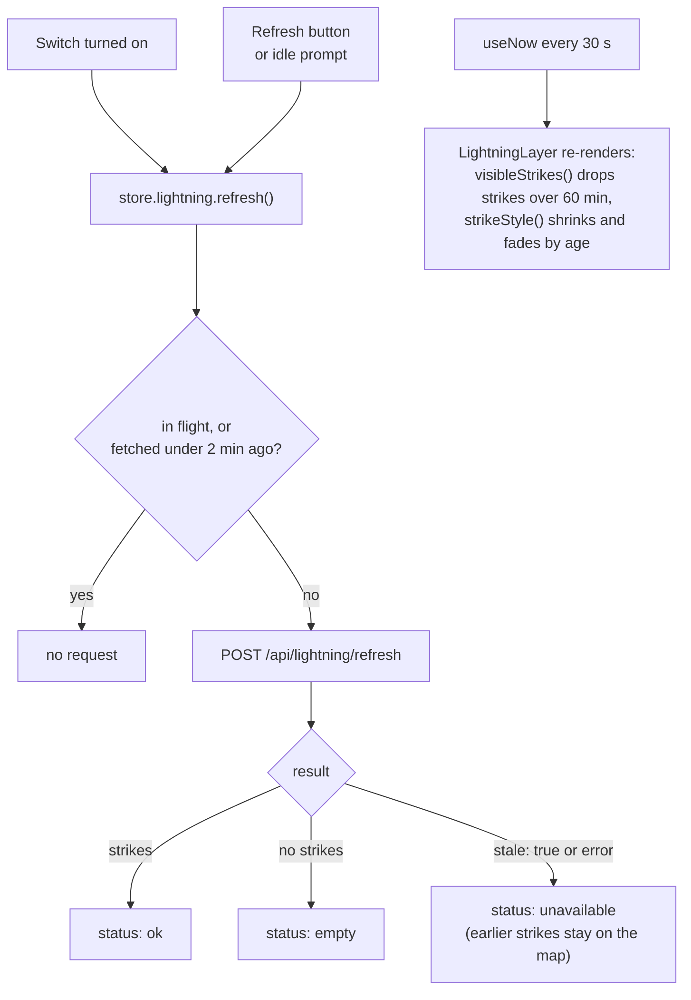

The map lives in `frontend/src/components/map/` and uses Leaflet through react-leaflet.

| File | Role |
| --- | --- |
| `MapCard.tsx` | Card in the hero: a non-interactive preview, the expand button and the lightning control |
| `MapFullscreen.tsx` | Fullscreen overlay rendered in a portal. Escape closes it, focus moves to the close button and returns afterwards. |
| `WeatherMap.tsx` | The map itself: CARTO tiles, pins, fit-to-bounds, focus on the selected location |
| `mapHelpers.ts` | Pure helpers: condition to icon, pin label, bounds, Singapore centre/bounds, coarse-pointer check |
| `LightningLayer.tsx` | One fading circle per strike |
| `LightningControl.tsx` | On/off switch, refresh button and status strip |
| `lightningHelpers.ts` | Pure lightning logic: freshness, visibility, fade style, status text, popup text |
| `useNow.ts` | A clock that re-renders on an interval |

## Pins

Pins come from the locations already in the store, so the map makes no weather calls of its own. Each pin is a `DivIcon` showing a condition icon (thunder, rain, cloud or sun, chosen by `conditionToIcon`) and a temperature label. Clicking a pin selects that location.

The card preview is not interactive. On touch devices, tapping its background opens the fullscreen map. Selecting a location, or refreshing the selected one, re-centres the map on it.

## Tiles

Tiles come from CARTO. The basemap style follows the active theme (`voyager`, `dark_all` or `light_all`, set per theme in `theme/themes.ts`). Set `VITE_CARTO_API_KEY` in `frontend/.env.local` to use keyed tile URLs; without it the map uses keyless tiles.

## Lightning layer

- **Never on page load.** Data is requested only by turning the layer on, pressing refresh, or clicking the idle prompt. On first load the status reads "Show latest lightning".
- **On/off is remembered** in `localStorage` under `weather-starter.lightning.enabled`. It defaults to on. Any value other than `"false"` counts as on.
- **Fading:** a strike's radius and opacity fall linearly from newest to 60 minutes old. The 30-second tick keeps this moving without network calls.
- **Own pane:** strikes are drawn in a custom Leaflet pane at z-index 450, between overlays (400) and markers (600), so location pins stay on top and clickable.
- **Colour** comes from the theme's `--lightning` CSS variable, with a yellow fallback.
- **Status strip** text comes from `statusMessage()`: idle, loading, "N strikes in the last hour", "No lightning in the last hour", or "Lightning data is currently unavailable", plus an "Updated" time in Singapore time.

The map's buttons and the lightning strip use a fixed dark-glass style (`bg-black/…` with `text-[#fff]`) so they stay readable on every basemap.
