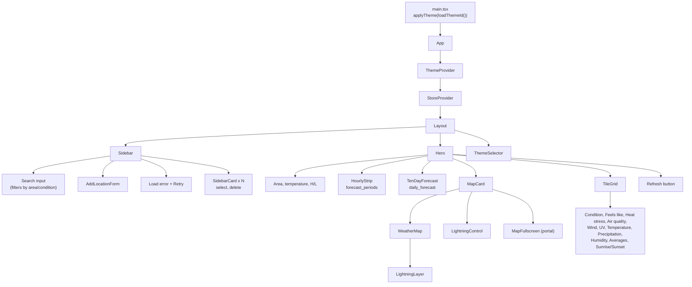
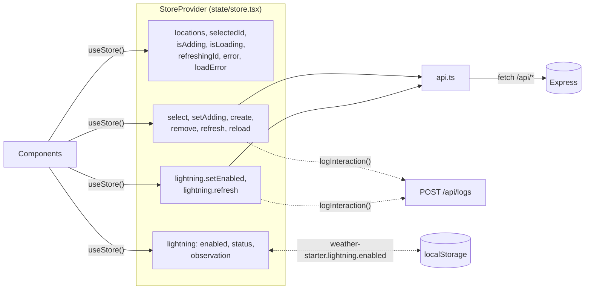

React 18, Tailwind 3 and Leaflet, built by Vite. There is no router: one page, one layout.

## Component tree

`Hero` returns early with a "Select a location" message when nothing is selected, so the map card and tiles only appear once a location exists.

## The store

All server state lives in one React context, `frontend/src/state/store.tsx`, backed by the fetch wrappers in `frontend/src/api.ts`. Components read it with `useStore()` and `useSelectedLocation()`.

| Action | API calls | Then |
| --- | --- | --- |
| mount | `GET /api/locations` | Select the first location |
| `create(payload)` | `POST /api/locations`, then `GET /api/locations` | Select the new location, close the form |
| `refresh(id)` | `POST /api/locations/:id/refresh`, then `GET /api/locations` | `refreshingId` is set while it runs |
| `remove(id)` | `DELETE /api/locations/:id` | Removed locally, no reload |
| `reload()` | `GET /api/locations` | Used by the sidebar Retry button |

Behaviour worth knowing:

- **Selection:** `selectedId` is derived. If the stored id no longer exists, the first location is selected.
- **Home:** the first location in the list (the newest) is labelled "Home" in the sidebar and hero.
- **Failed load:** the list already on screen is kept, and `loadError` shows in the sidebar with a Retry button. A failed load never looks like an empty list.
- **Errors from `create` and `remove`** are rethrown so the form and card can show them inline.

## API client

`api.ts` sends JSON to relative `/api` paths, so the same build works behind Portless or in production with no configuration. A non-OK response throws `Error(detail)` using the server's `detail` message. `204` resolves to `null`.

`logInteraction(event, metadata)` posts to `/api/logs` with `keepalive: true` and swallows failures, so logging never affects the UI.

## Missing values

Readings are often `null`: a location that was never refreshed, a station that did not report, or a failed upstream call. Most tiles show `--` or `--°`. The newer derived tiles show a "No reading" state instead (see [Derived tiles](/frontend/derived-tiles/)).
