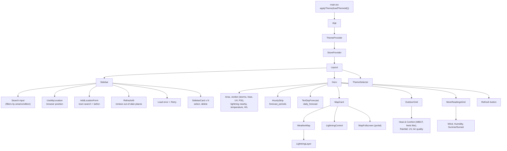
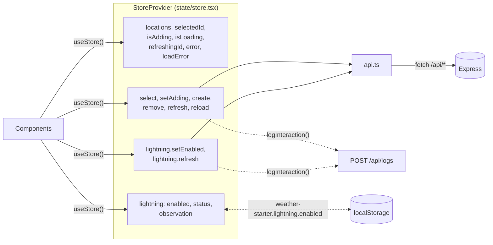

React 18, Tailwind 3 and Leaflet, built by Vite. There is no router: one page, one layout.

## Component tree

`Hero` returns early with a "Select a location" message when nothing is selected, so the map card and tiles only appear once a location exists.

## Refresh all

When two or more saved places are stale (older than three hours, see `components/freshness.ts`) or were never refreshed, `RefreshAll` offers "Refresh N out-of-date places": under the add row on desktop, and on phones in the sheet that the dock's Refresh button opens (the button shows a count badge). The store's `refreshAll` renews them one at a time through the same `POST /api/locations/:id/refresh` as a single Refresh, so the provider's request pacing still applies and each card updates as its turn ends. A polite status line counts progress, "Stop after this place" ends the run between places, and failures are named with a Retry for just those places. Single Refresh buttons are disabled during a run. It never starts on its own: weather is still fetched only on a user action.

## Adding a location

Two buttons share a row at the top of the sidebar: **Use my location** and **Add Location**.

**Use my location** (`UseMyLocation`) asks the browser for the position once per press; the browser's permission prompt is the consent. The pure module `components/geolocate.ts` decides what happens:

- **Outside Singapore** (the server's box, lat 1.1–1.5, lon 103.6–104.1): a message, and no request.
- **Within 100 m of a saved place:** that place is selected and "Already saved: <area>" shows.
- **Otherwise:** the position is added through the normal create flow and selected.

Denied permission, an unavailable position and a 10-second timeout each get their own message with a next step; messages can be dismissed and clear on the next press or when the add form opens. On Firefox and Safari, an unavailable or timed-out position adds that the feature has only been tested in Chrome; nothing warns before a press. Its logs carry the outcome and area, never the coordinates.

`AddLocationForm` offers two ways to fill the coordinates:

- **Town search.** A "Town" combobox (WAI-ARIA combobox and listbox pattern) searches a bundled list of the 47 NEA two-hour forecast areas (`components/towns.ts`), using the pure matcher `components/townSearch.ts`.
  - **Ranking:** exact name first, then start of the name, then start of any word, then near matches with one letter wrong, missing or extra (only for 3+ characters).
  - **Limit:** at most 8 results.
  - **Keyboard:** ↑/↓ move the highlight, Enter picks, and Escape closes the list. Enter on a highlighted town never submits the form.
- **Manual entry** of latitude and longitude, unchanged.

Picking a town fills both fields with the area's reference point. It does **not** save. The user presses Add as usual, so the server's bounds and duplicate checks still apply. If the picked town is within 200 m of a saved place, the form says it is already saved and offers "Show it". Editing the town text after a pick clears the picked coordinates and disables Add until a town is picked or coordinates are typed, so Add can't save a place the field no longer names. Searching makes no network call. Picking logs `location_town_picked` with the town name only, never the typed text.

## The store

All server state lives in one React context, `frontend/src/state/store.tsx`, backed by the fetch wrappers in `frontend/src/api.ts`. Components read it with `useStore()` and `useSelectedLocation()`.

| Action | API calls | Then |
| --- | --- | --- |
| mount | `GET /api/locations` | Select the first location |
| `create(payload)` | `POST /api/locations`, then `GET /api/locations` | Select the new location, close the form |
| `refresh(id)` | `POST /api/locations/:id/refresh`, then `GET /api/locations` | `refreshingId` is set while it runs |
| `remove(id)` | `DELETE /api/locations/:id` | Removed locally, no reload |
| `reload()` | `GET /api/locations` | Used by the sidebar Retry button |

Behaviour worth knowing:

- **Selection:** `selectedId` is derived. If the stored id no longer exists, the first location is selected.
- **Home:** the first location in the list (the newest) is labelled "Home" in the sidebar and hero.
- **Failed load:** the list already on screen is kept, and `loadError` shows in the sidebar with a Retry button. A failed load never looks like an empty list.
- **Errors from `create` and `remove`** are rethrown so the form and card can show them inline.

## API client

`api.ts` sends JSON to relative `/api` paths, so the same build works behind Portless or in production with no configuration. A non-OK response throws `Error(detail)` using the server's `detail` message. `204` resolves to `null`.

`logInteraction(event, metadata)` posts to `/api/logs` with `keepalive: true` and swallows failures, so logging never affects the UI.

## Missing values

Readings are often `null`: a location that was never refreshed, a station that did not report, or a failed upstream call. Most tiles show `--` or `--°`. The newer derived tiles show a "No reading" state instead (see [Derived tiles](/frontend/derived-tiles/)).
