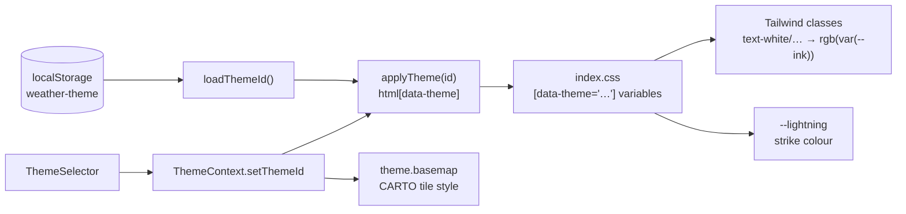

Themes are CSS-variable blocks in `frontend/src/index.css`, selected by a `data-theme` attribute on `<html>`.

`main.tsx` applies the saved theme before React renders, so there is no flash of the default theme.

## Available themes

Defined in `frontend/src/theme/themes.ts`:

| id | Label | Basemap |
| --- | --- | --- |
| `apple` (default) | Apple | `voyager` |
| `glass` | Apple Glass | `voyager` |
| `radar` | Midnight Radar | `dark_all` |
| `sticker` | Pastel Sticker | `light_all` |
| `memphis` | Neo-Memphis | `light_all` |

`apple` is the original design. Keep it visually unchanged.

## Rules for components

- **Use `white` classes for ink.** `tailwind.config.js` maps the `white` colour to `rgb(var(--ink) / <alpha-value>)`, so `text-white/70`, `border-white/10` and `bg-white/[0.08]` follow the theme. Light themes set `--ink` to a dark colour.
- **Literal white** for things that must stay white, such as icons on the map's dark buttons: use `text-[#fff]`.
- **Mark panels with `rounded-card`.** Its radius comes from `--card-radius`, and themes restyle panels through `[data-theme='…'] .rounded-card`.

## Adding a theme

1. Add a `[data-theme='your-id']` block in `index.css` that sets at least `--ink`, `--card-radius`, `--lightning` and the background variables the other themes set.
2. Add `{ id: 'your-id', label: '…', basemap: 'voyager' | 'dark_all' | 'light_all' }` to `THEMES`.
3. Check every component in the new theme, including the map controls and the lightning strip.
