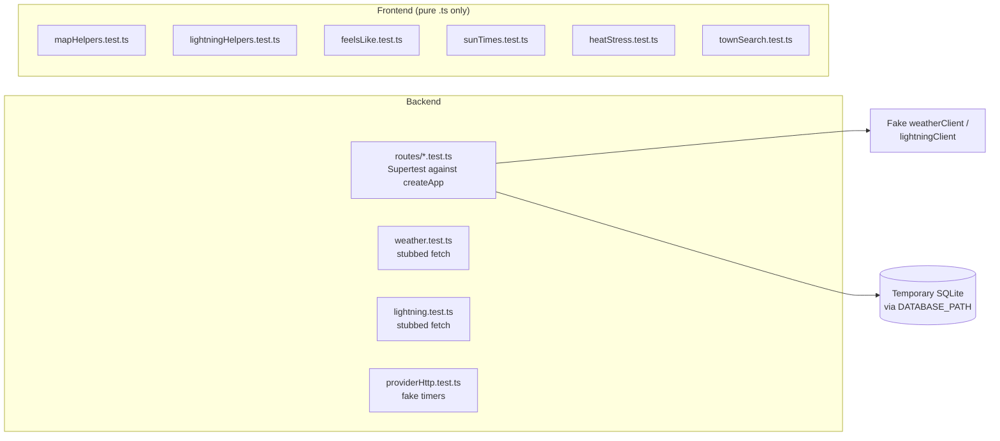

```bash
npm test                                   # everything
npx vitest run backend/src/weather.test.ts # one file
npx vitest run <file> -t "returns 409"     # one test
npm run test:watch
```

## Setup

`vitest.config.ts` at the repo root:

- includes `backend/src/**/*.test.ts` and `frontend/src/**/*.test.ts`,
- runs in the `node` environment,
- uses `pool: 'forks'` with `fileParallelism: false`, because route tests share SQLite,
- sets `NODE_ENV=test` and `LOG_LEVEL=silent`.

With `NODE_ENV=test`, `createApp` skips Vite, static files and request logging.

## What is tested where



## Backend route tests

Follow `backend/src/routes/locations.test.ts`:

1. Create a temporary directory and set `DATABASE_PATH` to a file inside it before importing the server.
2. Import `createApp` dynamically, because `db.ts` opens the database at import time.
3. Build the app with a fake provider and no frontend:

   ```ts
   const { createApp } = await import('../server.js');
   const app = await createApp({
     serveFrontend: false,
     enableRequestLogging: false,
     weatherClient: { getCurrentWeather: async () => snapshot },
   });
   ```

4. Drive it with `supertest`, reset rows between tests with `resetStore()`, and close with `closeDatabase()` at the end.

Tests must never reach data.gov.sg. Client-level tests (`weather.test.ts`, `lightning.test.ts`) stub `fetch` instead; `ProviderRequester` accepts a `fetchImpl` for this.

Real pacing would make each weather test wait about 10–20 seconds, so client tests construct clients with `{ requestIntervalMs: 0, rateLimitRetryDelayMs: 0 }`. Pacing itself is tested once, in `providerHttp.test.ts`, with `vi.useFakeTimers()`: spacing for each key tier, the 10-second 429 retry, and one queue shared by both clients.

## Frontend limits

There is no DOM environment, so components are not rendered in tests. Put any logic worth testing in a pure `.ts` module next to the component and test that, as `feelsLike.ts`, `heatStress.ts`, `sunTimes.ts`, `townSearch.ts`, `mapHelpers.ts` and `lightningHelpers.ts` do.

## Browser checks

Some UI behaviour can't be unit-tested without a DOM, so it's checked in a real browser on demand. These checks are **not** part of `npm test` or the pre-commit hook. They add to the vitest unit tests and don't replace them.

Each script starts its own temporary server on a throwaway database, so your own `backend/weather.db` and any `npm run dev` you have open are untouched:

```bash
npm run verify                              # builds frontend/dist, which the checks serve
scripts/e2e/town-search.sh                  # or: us1 | us2 | us3 | themes | a11y
scripts/e2e/use-my-location.sh              # or: us1 | us2 | us3 | us4 | themes
```

The server runs in production mode on a free `127.0.0.1` port, in its own process group. An `EXIT` trap kills it, closes every browser session and deletes the database, whether the run passed or failed. Set `E2E_BASE_URL=<url>` to use a server you run yourself, or `E2E_DATABASE_PATH=<file>` to keep the database between runs.

Before the first navigation the scripts clear agent-browser's page-error and console buffers. After each open, reload or view/sheet switch, `assert_clean` fails the run at once if an uncaught exception, unhandled rejection or `console.error` arrived. `E2E_ALLOW_ERRORS=<regex>` ignores known messages.

- **agent-browser** (`scripts/e2e/town-search.sh`) drives the add-location town search. It finds elements by ARIA role and accessible name, so a broken combobox contract fails the run. It also checks that every theme renders the town list legibly (screenshots), and runs an axe scan that must report 0 violations.
- **agent-browser** (`scripts/e2e/use-my-location.sh`) drives the "Use my location" button: adding your position, the 100 m already-saved rule, the denied and outside-Singapore messages, the Chrome-only hint that Firefox and Safari get when an attempt fails (FR-010), and every theme. It sets the position with `set geo` and grants the permission through CDP. Some agent-browser Chrome profiles ignore that grant; the script then stubs `navigator.geolocation` in the page and reports `Mode: stub`. Everything after the browser API still runs for real, and the browser's permission prompt is checked by hand (`specs/003-use-my-location/quickstart.md` §4).
- **chrome-devtools** (via MCPorter, `mcporter call chrome-devtools.<tool>`) is used for what agent-browser shouldn't own:
  - the raw network log (searching must make no data.gov.sg calls);
  - a performance trace while typing (INP);
  - Lighthouse accessibility.

Screenshots, scans and traces go to `e2e-artifacts/`, which is git-ignored. Each add triggers the normal create snapshot, so a full run makes real data.gov.sg calls for the locations it adds.

## Quality gate

The project constitution says no code may be committed unless `npm run lint` and `npm test` both pass, enforced by a Husky pre-commit hook. Husky is installed (`npm install` runs `husky` via `prepare`), and `.husky/pre-commit` runs `npm run lint` and `npm test`. Do not bypass it with `--no-verify`.

`npm run verify` is a stricter on-demand gate. It runs ESLint, then `tsc --noEmit` for frontend and backend, then vitest, then `npm run build`, and stops at the first failure. Ruff, pyright/mypy and pytest stages are wired in through `scripts/verify-python.sh` and skip while the repo has no Python. Run it before browser checks and before calling a change done. It doesn't change the pre-commit hook.
