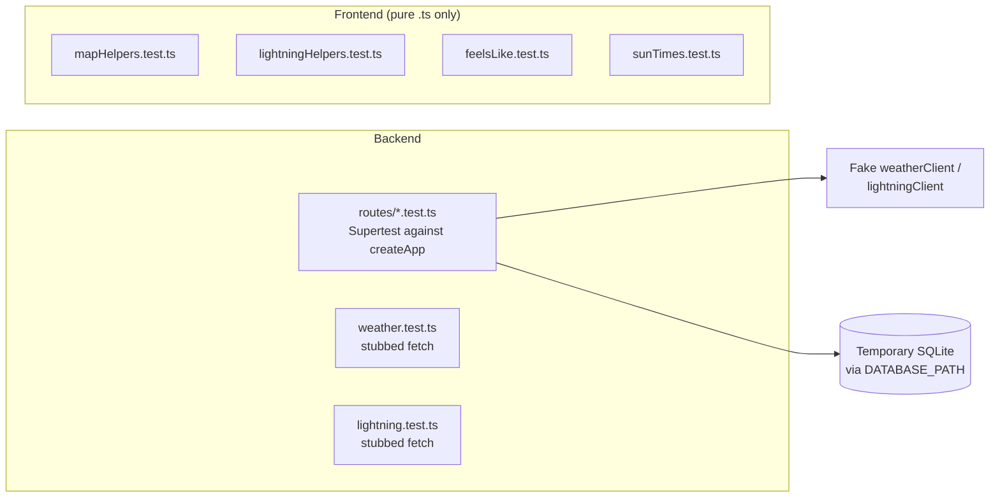

```bash
npm test                                   # everything
npx vitest run backend/src/weather.test.ts # one file
npx vitest run <file> -t "returns 409"     # one test
npm run test:watch
```

## Setup

`vitest.config.ts` at the repo root:

- includes `backend/src/**/*.test.ts` and `frontend/src/**/*.test.ts`,
- runs in the `node` environment,
- uses `pool: 'forks'` with `fileParallelism: false`, because route tests share SQLite,
- sets `NODE_ENV=test` and `LOG_LEVEL=silent`.

With `NODE_ENV=test`, `createApp` skips Vite, static files and request logging.

## What is tested where



## Backend route tests

Follow `backend/src/routes/locations.test.ts`:

1. Create a temporary directory and set `DATABASE_PATH` to a file inside it before importing the server.
2. Import `createApp` dynamically, because `db.ts` opens the database at import time.
3. Build the app with a fake provider and no frontend:

   ```ts
   const { createApp } = await import('../server.js');
   const app = await createApp({
     serveFrontend: false,
     enableRequestLogging: false,
     weatherClient: { getCurrentWeather: async () => snapshot },
   });
   ```

4. Drive it with `supertest`, reset rows between tests with `resetStore()`, and close with `closeDatabase()` at the end.

Tests must never reach data.gov.sg. Client-level tests (`weather.test.ts`, `lightning.test.ts`) stub `fetch` instead; `ProviderRequester` accepts a `fetchImpl` for this.

## Frontend limits

There is no DOM environment, so components are not rendered in tests. Put any logic worth testing in a pure `.ts` module next to the component and test that, as `feelsLike.ts`, `sunTimes.ts`, `mapHelpers.ts` and `lightningHelpers.ts` do.

## Quality gate

The project constitution says no code may be committed unless `npm run lint` and `npm test` both pass, enforced by a Husky pre-commit hook. Husky is installed (`npm install` runs `husky` via `prepare`), but `.husky/pre-commit` is currently empty, so nothing runs on commit yet. Run both commands yourself before committing.
